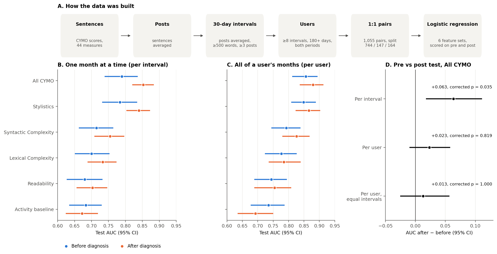

# CYMO Depression vs Control Classification

Oct 30, 2026

Logistic regression on 44 CYMO measures separates depression from control users at AUC 0.856 before diagnosis and 0.879 after, per user. A paired test finds single 30-day intervals are significantly easier to classify after diagnosis (AUC +0.063, corrected p = 0.035). Per user there is no significant difference (+0.023, corrected p = 0.819), and the interval gap may reflect post-diagnosis intervals holding more posts.

## Methodology

One training example is one user's 30-day interval, holding the average of 44 CYMO measures. Rows are built in six steps:

1. **Start with sentences:** the raw CYMO file has one row per sentence, and 44 measures are kept.
2. **Sentences to posts:** each post's sentences are averaged.
3. **Posts to intervals:** posts are averaged within 30-day windows counted from the user's diagnosis date.
4. **Filter intervals:** an interval needs at least 500 words and 3 posts.
5. **Filter users:** a user needs at least 8 valid intervals over 180+ days, with valid intervals before and after the date.
6. **Label rows:** `label` is depression or control, and `period` is pre or post the date.

Example for a user with a diagnosis date of 1 June:

| Window | Period | Posts | Words | Each of the 44 measures | Kept? |
| --- | --- | --: | --: | --- | --- |
| 2 May – 31 May | Pre | 12 | 900 | Average of 12 posts | Yes |
| 1 Jun – 30 Jun | Post | 2 | 700 | Average of 2 posts | No, under 3 posts |
| 1 Jul – 30 Jul | Post | 20 | 1,500 | Average of 20 posts | Yes |

The 4 CYMO categories do not group rows. They only choose which columns a model sees, and measures within a category stay separate inputs.

- **Cohort:** 1,055 of 5,365 dated depression users pass step 5.
- **Pairing:** each depression user is paired 1:1 with one unused control with similar pre and post interval counts.
- **Diagnosis date:** this is the user's first disclosure post, a proxy for the real date. A control takes their paired user's date as a pseudo-date.

## Models and splits

18 L2 logistic regression models were trained: 6 feature sets × 3 training periods (pre + post, pre only, post only). The feature sets are the 4 CYMO categories, all 44 measures, and an activity baseline (`n_posts`, `n_words`). C was chosen on validation AUC, and each model is scored separately on pre and post test data. Period and time are not model inputs.

| Split | Pairs | Users | Pre intervals | Post intervals | Total intervals |
| --- | --: | --: | --: | --: | --: |
| Train | 744 | 1,488 | 9,201 | 13,705 | 22,906 |
| Validation | 147 | 294 | 1,587 | 2,691 | 4,278 |
| Test | 164 | 328 | 1,952 | 3,090 | 5,042 |

A pair stays in one split, so no user appears in two.

## How scoring works

The model gives every test interval a probability of being depression. Scores are then computed at two levels, and both pool all test users:

- **Per interval:** each 30-day window is its own test case (1,952 pre, 3,090 post). This asks whether one month of posts identifies the group.
- **Per user:** a user's probabilities are averaged within a period, giving one case per user (328 in each period). This asks whether all their months together identify the group.

Example with one depression user and one control, three windows each:

| User | Window 1 | Window 2 | Window 3 | User average |
| --- | --: | --: | --: | --: |
| Depression | 0.80 | 0.45 | 0.70 | 0.65 |
| Control | 0.30 | 0.55 | 0.35 | 0.40 |

Per interval, the model slips once, because the depression window at 0.45 sits below the control window at 0.55. Per user, it ranks the two correctly, because averaging smooths out the bad month.

AUC measures how often a depression case ranks above a control case. It compares groups, not one user's pre and post intervals, so a pre vs post difference does not show that any user's language changed.

Confidence intervals come from a bootstrap: 164 pairs are redrawn with replacement, the score is recomputed, and the middle 95% of draws is kept. Whole pairs are redrawn, and the model is not retrained.

## Results

All CYMO measures perform best, and Stylistics carries most of that signal. Scores are test AUC with 95% CIs from resampling pairs, for models trained on pre + post data. Per-user scores average a user's interval probabilities within each period.

| Feature set | Features | Pre, per user | Post, per user | Pre, per interval | Post, per interval |
| --- | --: | --: | --: | --: | --: |
| All CYMO | 44 | 0.856 [0.812, 0.894] | 0.879 [0.837, 0.914] | 0.790 [0.739, 0.836] | 0.853 [0.820, 0.884] |
| Stylistics | 27 | 0.849 [0.809, 0.888] | 0.866 [0.823, 0.903] | 0.784 [0.732, 0.835] | 0.840 [0.803, 0.873] |
| Syntactic Complexity | 8 | 0.792 [0.744, 0.839] | 0.826 [0.780, 0.869] | 0.715 [0.662, 0.764] | 0.755 [0.708, 0.797] |
| Lexical Complexity | 2 | 0.777 [0.723, 0.826] | 0.785 [0.736, 0.839] | 0.700 [0.651, 0.753] | 0.733 [0.688, 0.774] |
| Readability | 7 | 0.744 [0.688, 0.795] | 0.755 [0.689, 0.809] | 0.680 [0.627, 0.732] | 0.703 [0.656, 0.746] |
| Activity baseline | 2 | 0.735 [0.677, 0.787] | 0.693 [0.635, 0.750] | 0.683 [0.634, 0.730] | 0.672 [0.624, 0.719] |

Per-user accuracy for All CYMO is 0.771 pre and 0.805 post. Models trained on one period only give nearly the same result: 0.855 pre-only on pre, and 0.879 post-only on post.

## Pre vs post test

Post is significantly better only for All CYMO per interval. The test takes post AUC minus pre AUC within each of 10,000 bootstrap draws of the same pairs, with a permutation test that randomly swaps a pair's periods as a check.

For example, per interval: all pre intervals from all users give AUC 0.790, all post intervals give 0.853, so the difference is +0.063.

| All CYMO, trained on pre + post | AUC post − pre | 95% CI | p | Corrected p |
| --- | --: | --: | --: | --: |
| Per interval | +0.063 | [+0.018, +0.111] | 0.006 | 0.035 |
| Per user | +0.023 | [−0.010, +0.058] | 0.168 | 0.819 |
| Per user, equal intervals | +0.013 | [−0.026, +0.057] | 0.481 | 1.000 |

Corrected p uses Holm across the 6 feature sets at each level. "Equal intervals" cuts each user's periods to the same number of random intervals, because users have more post intervals than pre.

- **Other feature sets:** none passes after correction. Stylistics per interval comes closest at +0.056 (corrected p = 0.103).
- **Separate period models:** pre-only and post-only models agree, at +0.066 per interval (corrected p = 0.028).
- **Permutation test:** it agrees with the bootstrap, at p = 0.004 for All CYMO per interval.

One month of a user's language is more identifiable after diagnosis, by about 0.06 AUC. A user's overall profile is not shown to be.

## Caveats

- **Volume:** the activity baseline alone reaches 0.67–0.74, so CYMO scores should be compared with that rather than 0.5. Pairing did not match on word count.
- **Control selection:** controls with any mental-health mention in their history were excluded, which may inflate separation.
- **Diagnosis proxy:** first disclosure can come well after diagnosis, so some "pre" data may really be post-diagnosis.
- **Feature set:** the 44 measures come from a storage-type list, so 300 of the 344 are excluded, including all emotion and pronoun measures.
- **Interval gap may be a volume effect:** post intervals hold more posts (about 20 vs 16 for depression users, 22 vs 18 for controls), so their averages are less noisy. This was not controlled in the test.
- **Multiple testing:** correction is within each level, not across all 36 tests. The interval result would not clear 0.05 across all 36.
